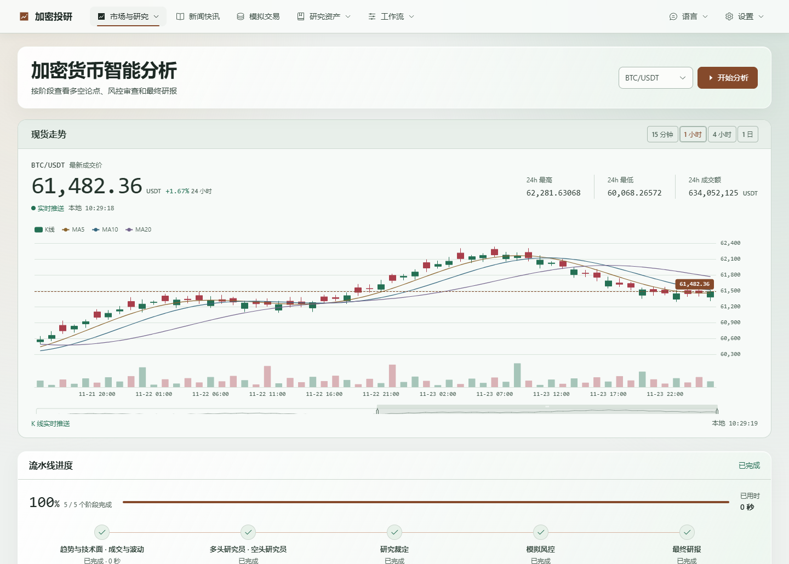
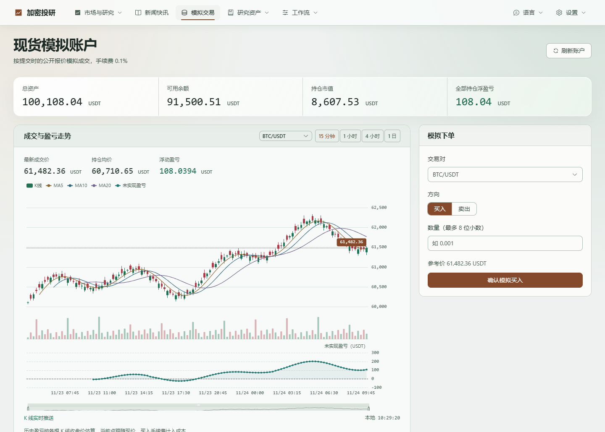
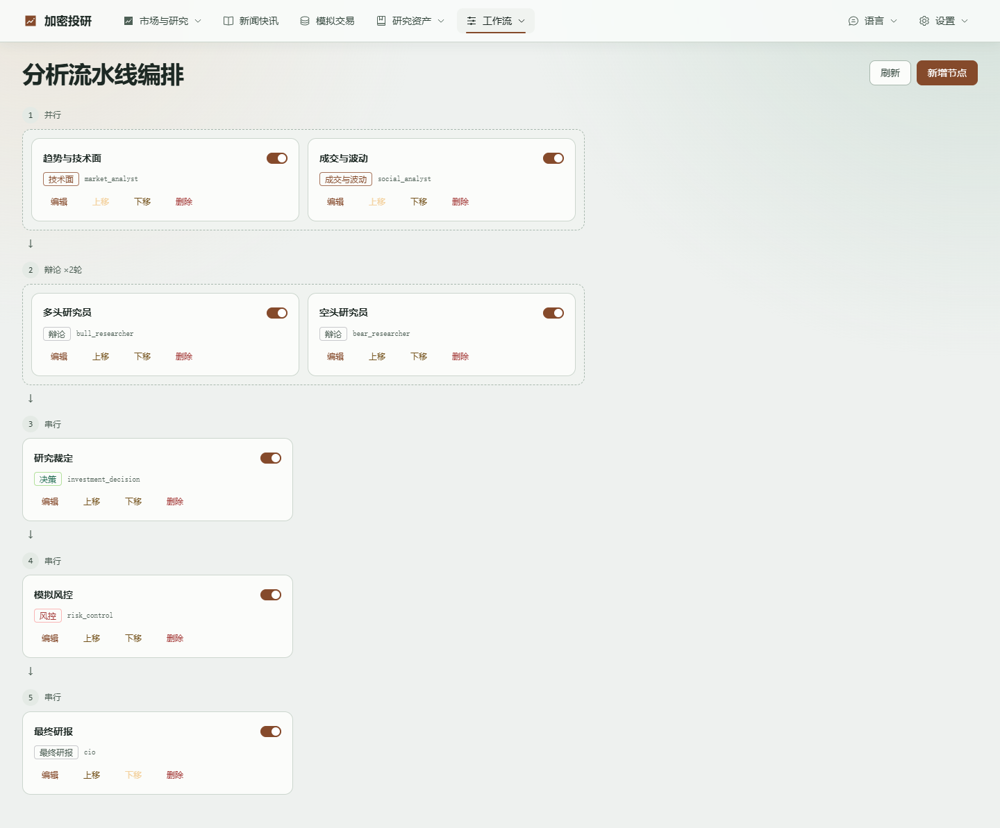

# 加密投研 · Crypto Trading Agents

一个在本机运行的加密现货投研工作台。它把实时行情、多智能体分析、研报、模拟交易和持仓复盘连在一起。默认用 Ollama 在本地运行模型，从 Binance 获取公开行情。

[页面预览](#页面预览) · [服务介绍](#服务介绍) · [本地部署](#本地部署) · [配置与排查](#配置与排查)

## 页面预览

截图使用演示行情和账户数据。

### 智能分析

在同一页查看实时 K 线、分析阶段进度和节点产出。分析中断后可以从已完成的阶段继续。



### 模拟交易

使用公开报价模拟买卖，在图表上方查看现价、持仓均价和浮动盈亏。



### Agent 流水线

从界面调整节点顺序、模型、系统提示词及多空辩论轮数。



## 服务介绍

| 服务 | 运行方式 | 负责内容 |
| --- | --- | --- |
| Web 工作台 | Vue 3、Element Plus、ECharts、Vite · `127.0.0.1:3000` | 行情图表、Agent 配置、分析进度、研报、顾问和模拟账户。Vite 将 `/api` 代理到后端。 |
| 投研 API | Java 21、Spring Boot 3.4、Spring AI 1.0 · `127.0.0.1:8080` | 编排 Agent、保存阶段结果、通过 SSE 推送进度、处理模拟成交和定时复盘。 |
| 模型服务 | Ollama · `127.0.0.1:11434` | `qwen2.5:7b` 负责分析和对话，`nomic-embed-text` 负责向量嵌入。 |
| 数据存储 | Docker Compose 中的 TimescaleDB（PostgreSQL 16）和 PgVector · `127.0.0.1:5432` | 存储研报、成交、持仓、定时任务和可检索的复盘经验。Flyway 在后端首次启动时初始化。 |

- **实时行情**　默认提供 BTC、ETH、SOL、BNB、XRP、DOGE 的 USDT 现货交易对。WebSocket 更新现价与 15 分钟、1 小时、4 小时及 1 日 K 线。HTTP 加载历史、补齐重连缺口，并在断线期间轮询。
- **多智能体分析**　默认 5 个阶段、7 个 Agent 节点，依次完成量价与技术分析、多空辩论、研究裁定、风控和研报生成。投研顾问可调用行情、模拟持仓和经验检索工具。
- **模拟交易与复盘**　初始模拟余额为 100,000 USDT，支持小数数量和双向 0.1% 手续费。研报信号由用户确认后模拟成交，同一账户对同一报告只成交一次。可在「工作流 → 定时任务」调整 UTC Cron、暂停或立即复盘。
- **新闻快讯**　聚合市场与监管 RSS，在浏览时按界面语言生成并缓存中英文摘要和 AI 解读。新闻与 Binance 行情需要网络连接。

## 本地部署

以下使用 Windows PowerShell。macOS 或 Linux 可以将 Maven 命令换成 `./mvnw`，其余基础启动命令相同。

### 1. 安装依赖并克隆

准备 Git、JDK 21、含 npm 的 Node.js 22 或 24、Docker Compose v2 和 Ollama。先启动 Docker Desktop 或 Docker Engine，再在终端检查依赖。[JDK 21](https://adoptium.net/temurin/releases/?version=21) · [Node.js](https://nodejs.org/en/download) · [Docker](https://docs.docker.com/get-docker/) · [Ollama](https://ollama.com/download)

```powershell
git --version
java -version
node --version
npm --version
docker compose version
ollama --version
```

使用对仓库有访问权限的 GitHub 账号克隆项目。

```powershell
git clone https://github.com/daly-wmh/crypto-trading-agents.git
cd crypto-trading-agents
```

### 2. 启动数据库

在仓库根目录运行以下命令，确认 `timescaledb` 显示 `healthy`。数据库文件保存在 Docker 命名卷中。[Docker Compose 启动文档](https://docs.docker.com/reference/cli/docker/compose/up/)

```powershell
docker compose up -d --wait
docker compose ps
```

### 3. 启动 Ollama 并下载模型

先执行 `ollama list`。如果无法连接，打开 Ollama 应用，或在单独的终端运行 `ollama serve` 并保留该终端。下载完成后，`ollama list` 应列出下方两个模型。[Ollama CLI 文档](https://docs.ollama.com/cli)

```powershell
ollama pull qwen2.5:7b
ollama pull nomic-embed-text
ollama list
```

### 4. 启动后端

在仓库根目录的新终端运行以下命令，等待 Spring Boot 输出启动成功的日志。也可以在 IntelliJ IDEA 中导入 `pom.xml`，将 Project SDK 设为 JDK 21，再运行 `com.tradingagents.TradingAgentsApplication`。

```powershell
.\mvnw.cmd spring-boot:run
```

### 5. 启动前端并验证

另开终端，从仓库根目录运行以下命令。打开 [本地工作台](http://127.0.0.1:3000/)，确认能看到交易对，选一个标的后点击「开始分析」。默认模型和公开行情无需交易所 API Key。

```powershell
cd frontend
npm ci
npm run dev
```

可在另一个终端检查后端和 Ollama 是否有响应。

```powershell
Invoke-RestMethod http://127.0.0.1:8080/api/market/pairs
Invoke-RestMethod http://127.0.0.1:11434/api/tags
```

退出时在前后端终端按 `Ctrl+C`，再从仓库根目录运行 `docker compose stop`。下次启动可继续使用原有数据库卷。

## 配置与排查

### 常用环境变量

| 变量 | 设置位置 | 用途 |
| --- | --- | --- |
| `CRYPTO_PORT` | 后端 | 后端端口，默认 `8080`。 |
| `CRYPTO_API_URL` | 前端 | Vite 的 API 代理目标，默认 `http://127.0.0.1:8080`。 |
| `CRYPTO_DB_PORT`、`CRYPTO_DB_NAME` | Docker Compose | 数据库映射端口和库名，默认 `5432` 与 `crypto_agents`。修改后同步调整后端 JDBC 地址。 |
| `CRYPTO_DB_URL`、`CRYPTO_DB_USER`、`CRYPTO_DB_PASSWORD` | 后端 | JDBC 连接参数。自定义用户和密码时，Compose 与后端应使用相同的值。 |
| `CRYPTO_OLLAMA_URL`、`CRYPTO_OLLAMA_MODEL` | 后端 | Ollama 地址和默认对话模型。 |
| `CRYPTO_EMBEDDING_MODEL`、`CRYPTO_EMBEDDING_DIMENSIONS` | 后端 | 嵌入模型和向量维度，默认 `nomic-embed-text` 与 `768`。 |
| `CRYPTO_PAIRS`、`CRYPTO_MARKET_URL` | 后端 | 逗号分隔的现货交易对，以及 Binance REST 行情地址。 |
| `CRYPTO_REFLECTION_CRON` | 后端 | 持仓复盘的默认 UTC Cron，页面保存的计划优先。 |

环境变量应设置在启动对应服务的终端中。若后端 `8080` 和前端 `3000` 已被占用，可在后端终端设置 `$env:CRYPTO_PORT = '8081'`，在前端终端设置 `$env:CRYPTO_API_URL = 'http://127.0.0.1:8081'`，然后运行 `npm run dev -- --port 3001`。

- **数据库连接失败**　通过 `docker compose ps` 检查健康状态，通过 `docker compose logs timescaledb` 查看启动日志。数据库端口、用户名和密码应与 JDBC 配置一致。
- **模型找不到或无法连接**　用 `ollama list` 核对安装的模型名，通过 `/api/tags` 确认本地服务有响应。使用 OpenAI 兼容 API 时，在「系统设置」添加模型源并设为全局默认，将 API Key 配置为后端进程的环境变量。
- **行情或新闻为空**　先用 `/api/market/pairs` 确认后端连通，再检查 Binance REST、WebSocket 和 RSS 在本机网络上是否可达。

## 测试与构建

在仓库根目录运行后端集成测试。测试使用隔离数据库和模拟上游，覆盖分析失败续跑、模拟成交与重复确认去重等流程。

```powershell
.\mvnw.cmd verify
```

在 `frontend` 目录运行 `npm run build` 生成前端构建产物，并可用 `npm run preview -- --port 3000` 在本机查看。

## 来源与许可

参考并改编自 BlackmodeN/trading-agents-java，行情使用 Binance 公开现货接口。[原始项目](https://github.com/BlackmodeN/trading-agents-java/tree/1a13d92b9d00b81a4461618f4b90754cb70ed429) · [Binance 行情接口](https://developers.binance.com/en/docs/products/spot/faqs/market_data_only) · [Apache 2.0 许可](LICENSE)
